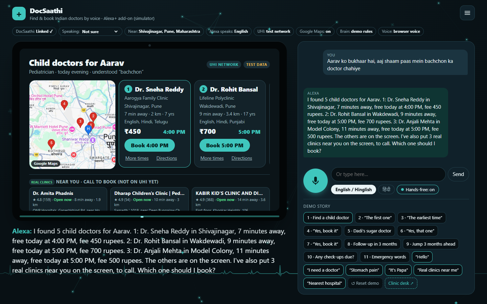
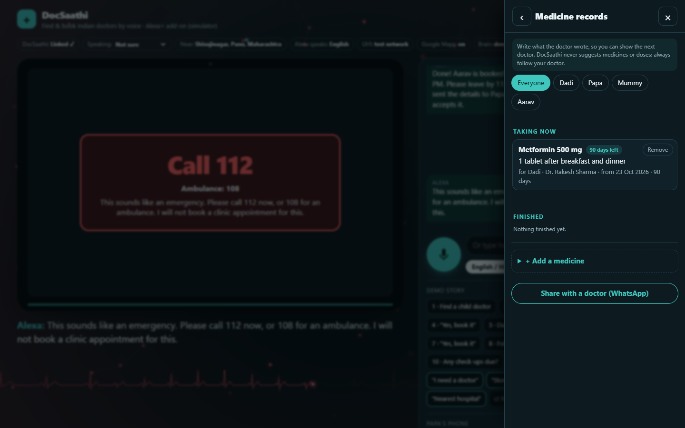

# DocSaathi: find and book Indian doctors by voice on Alexa+

**Alexa+ launched in India on 16 September 2026 with no health partners. DocSaathi connects Alexa+ to India's doctor network.**

**Demo video:** [youtu.be/mMd9LW-GB5U](https://youtu.be/mMd9LW-GB5U) (2 min 27 s) · **Product feedback:** [docs/PRODUCT_FEEDBACK.md](docs/PRODUCT_FEEDBACK.md) ·
**Friction log:** [docs/FRICTION_LOG.md](docs/FRICTION_LOG.md) · **License:** MIT



A family says, in Hindi, English or Hinglish:

> "Alexa, Aarav ko bukhaar hai, aaj shaam paas mein bachchon ka doctor chahiye."
> *(Aarav has a fever; we need a child doctor nearby this evening.)*

DocSaathi turns everyday words ("bachchon ka doctor", "sugar wale doctor", "Dadi", "kal subah") into a search on
**UHI**, India's open doctor-booking network (Unified Health Interface, part of the Ayushman Bharat Digital Mission).
It shows the nearest doctors with free times on the Echo Show, holds a time, asks **"Shall I book it?"**, and books it.
It gives the family a leave-by time, messages another family member, and **remembers each person's doctors and follow-ups**.

Built for the **Build, Ship, Shape: Amazon Developer Hackathon (Alexa+ track)** as a self-hosted
**MCP server (Streamable HTTP)** with an **MCP Apps** screen.

## How DocSaathi meets the judging criteria

| Criterion | What DocSaathi does | Where to look |
|---|---|---|
| **Technical implementation** | A self-hosted MCP server (Streamable HTTP; spec 2025-11-25, which Alexa+ speaks, and 2026-07-28 on the same endpoint) with 15 tools and an MCP Apps screen for Echo Show. OAuth 2.1 account linking built to Amazon's Alexa+ auth rules. India's UHI booking protocol with signed messages. Amazon Bedrock as the brain (gpt-oss-120b; Claude built in) and Amazon Polly as the voice. 80 unit tests plus end-to-end and browser checks. | [mcp.ts](src/server/mcp.ts), [oauth.ts](src/server/oauth.ts), [uhi/](src/server/uhi), [claude.ts](src/server/brain/claude.ts), [voice.ts](src/server/voice.ts) |
| **Design** | Voice first, screen second: cards readable across the room, a confirm card before every booking, answers in Hindi or English, a hands-free mic you can interrupt ("roko"), a ☰ menu for everything, and a phone layout. | [src/views](src/views), [src/web](src/web) |
| **Potential impact** | Alexa+ came to India with no health partner. Indian homes are often three generations, and many elders cannot use booking apps. DocSaathi books for the whole family in their own words, sends emergencies to 112 / 108 / 14416 instead of booking, keeps a family health record to show the next doctor, and finds cheaper Jan Aushadhi medicine shops. | [Safety](#safety-and-privacy) |
| **Quality of the idea** | It connects Alexa+ to India's open UHI network, not to one company's clinics, so any clinic on UHI can be booked. It remembers each person's usual doctor and follow-ups, asks who is talking instead of guessing, and the clinic desk answers back. Accuracy is measured on 103 family sentences. | [Accuracy](#accuracy) |
| **Friction log and feedback** | 11 detailed entries, and answers to the five feedback questions. | [FRICTION_LOG.md](docs/FRICTION_LOG.md), [PRODUCT_FEEDBACK.md](docs/PRODUCT_FEEDBACK.md) |

---

## Run it (2 commands)

Needs **Node.js 22.13 or newer** and **Google Chrome** (for voice). No accounts or keys are needed.

```bash
npm install
npm start
```

Open **http://localhost:3000/alexa** in Chrome. First tap **Link account**, like enabling a skill in the Alexa app: DocSaathi's
sign-in page opens, tap **Use test family** (mobile 00000 11111, PIN 1234), then **Allow**. This is real OAuth 2.1 account linking
(see [Account linking](#account-linking-oauth-21)), and you do it once.

Then tap the mic once (allow microphone access) and just talk: with **Hands-free** on,
the mic opens again by itself after each answer, like a real Echo in a conversation. Or tap the **Demo story** buttons:

1. **Find a child doctor**: Hinglish request, nearest child doctors with free times
2. **"Pehla wala"** ("the first one"): that doctor's free times, and Alexa asks which time
3. **"Sabse pehla time"** ("the earliest time"): the confirm card, with the clinic's instructions
4. **"Haan, book kar do"** ("yes, book it"): booked over UHI, leave-by time, message to Papa's phone
5. **Dadi's sugar doctor**: Alexa remembers Dadi's usual doctor from a past visit
6. and 7. **"Haan"** twice: the confirm card ("come fasting") and the booking
8. **Follow-up in 3 months**: "Doctor ne kaha 3 mahine baad wapas aana hai" (the doctor said come back in 3 months) is remembered
9. and 10. **Jump 3 months ahead**, then "Koi checkup due hai?" (any check-ups due?): the reminder
11. **Emergency words**: "Papa ke seene mein dard hai" (Papa has chest pain) gives "Call 112" and nothing is booked

**Reset demo** puts everything back to the start.

It also talks like a person, not a search box:

- **"Hello"** gets a greeting, not a doctor list.
- **"Mujhe doctor ko dikhana hai"** (I need to see a doctor): Alexa asks what the problem is. **"Pet mein dard hai"** (stomach pain):
  it picks the right kind of doctor. It only routes to a kind of doctor; it never diagnoses or suggests medicines.
- If nobody was named, Alexa asks **who it is for**. A new name ("Rohit") is added to the family after asking the age.
- **Anyone in the family can talk.** Nobody is assumed: when someone says "mujhe bukhaar hai" (I have a fever), Alexa asks
  **"Who am I speaking with?"** and remembers the answer for that conversation. You can also just say **"Main Papa hoon"**,
  **"I am Rajesh"** or **"Mera naam Kabir hai"** (someone new), or pick a person in the **Speaking:** menu. A real Echo would know
  this from each person's voice (Alexa voice ID). After "bye" or 10 quiet minutes it is forgotten, because the next person
  may be someone else.
- **Near you**: the page asks for your device's location once (or say **"I live in Rohini, Delhi"**). The test clinics
  move to your city, and the real clinics from Google Maps are the ones near you.

- **Hindi or English answers**: say **"Hindi mein bolo"** and Alexa answers in Hindi (in a Hindi voice); **"speak in English"**
  switches back. The **Alexa speaks:** button does the same. The Hindi sentences are written by hand from the same data the
  screen uses (`src/server/brain/hindi.ts`), so times, fees and the emergency numbers are exact.

What is real and what is test data (it is marked on every screen):

- **Test data:** the doctors Alexa can *book* (39 example doctors in 16 example clinics, on a local network that speaks the real
  UHI protocol). No real clinic receives a booking. Their addresses use the real name of the area they sit in on the map.
- **Real, from Google Maps** (needs a key): clinics near you under every doctor list, **"Real clinics near me"**,
  **"Sabse paas ka hospital kahan hai"** (nearest hospital), chemists and labs, with phone number (tap to call), rating, open now
  and directions; live-traffic travel times and the leave-by time; and the nearest hospitals under "Call 112" in an emergency.
- **Real, one tap after a booking:** **Directions** (Google Maps), **Add to Google Calendar**, **Share on WhatsApp**.

### The ☰ menu and the family's health record

The **☰** button (top right) opens everything DocSaathi can do, one tap away: the kinds of doctor, the family's appointments and
check-ups, the nearest chemist, **Jan Aushadhi** shops (government shops with cheaper generic medicines), labs, the nearest hospital,
and the emergency numbers (they ask before dialling). Most buttons simply say a sentence to Alexa.

Two pages keep the **family's health record**, so nobody has to remember it at the next doctor:

- **Doctors we visited:** every doctor each person saw, with the date. DocSaathi bookings appear by themselves; other visits can be added.
- **Medicine records:** what each doctor wrote (the medicine as written, how to take it, for how many days), with "12 days left" or
  "finished". It is a record of the doctor's words only: DocSaathi never suggests a medicine.
- **Share with a doctor:** sends the list on WhatsApp. Every entry shows who added it.



### Optional: an AI model that understands any phrasing

Without any key, the simulator's "Alexa" is a rule-based brain (`BRAIN=demo`): it understands the demo story and many everyday
variations. With an AI model, a language model does the understanding and picks the MCP tools, the way Alexa+ would:

- **Amazon Bedrock** (`BRAIN=bedrock`, an AWS key in `.env`). First **Claude** (Haiku 5.5, then Haiku 4.5) through Anthropic's
  official Bedrock SDK ([claude.ts](src/server/brain/claude.ts)); then **`openai.gpt-oss-120b`** through Bedrock's OpenAI-compatible
  endpoint, signed with the same IAM key ([bedrock-openai.ts](src/server/brain/bedrock-openai.ts)). On our own AWS account Amazon says
  Anthropic's models are "not available for this account", so DocSaathi's live brain is **gpt-oss-120b on Amazon Bedrock**
  (`BEDROCK_MODELS=off` skips Claude). Setup in about 20 minutes: [docs/AWS_SETUP.md](docs/AWS_SETUP.md), then `npm run check:aws`
  tests the keys in plain words.
- **Groq** (`BRAIN=groq`, a free key from [console.groq.com](https://console.groq.com)): `openai/gpt-oss-120b`. With `BRAIN=bedrock`,
  Groq also answers when Bedrock cannot (no access yet, network, daily limit).

> "yaar meri tabiyat kuch theek nahi lag rahi" → *"I'm sorry you're not feeling well. What symptoms do you have?"*
> "meri beti ke daant mein dard hai, kal ke liye doctor dikha do" → asks her name and age, adds her, finds a dentist for tomorrow

The safety rules do **not** depend on the model (`src/server/brain/ai.ts`):

- Our own word check catches emergencies before the model sees them.
- A booking is confirmed only after the person says yes, in a later turn than the hold.
- The model never picks the patient or the time by itself: if the person did not say it, Alexa asks.
- "Found / held / booked" is only ever said from a real tool result, and medicine names are never spoken.
- If no model can answer (busy, no access, network, the daily limit), the rule brain answers that turn.

With `BRAIN=bedrock` or `groq`, what the family says and their first names and ages are sent to Amazon Bedrock or Groq.
Try it with `npx tsx scripts/try-ai.ts`.

### Optional: Alexa's voice from Amazon Polly

With `VOICE=polly` (the same AWS key), Alexa speaks with Amazon Polly's **Kajal** voice, which speaks Hindi and Indian English
([src/server/voice.ts](src/server/voice.ts)). An answer spoken once is kept in `data/voice-cache`, so repeating it is free.
If Polly is off, slow or fails, the browser's own voice speaks instead, and "roko" still interrupts her.

Daily limits keep the AWS bill to cents: `BEDROCK_DAILY_LIMIT` requests and `POLLY_DAILY_CHARS` characters. They are counted in
`data/aws-usage.json`, so a restart does not reset them. If AWS cannot be reached, DocSaathi stops asking it for a few minutes,
so answers never wait for a time-out.

---

## How it works

```
  Family (voice) ──► Alexa+  ── MCP (Streamable HTTP) ──►  DocSaathi MCP server
                    (simulator)   + OAuth 2.1 token        │  15 tools + ui://docsaathi/screen.html (MCP App)
                                                           │  OAuth 2.1 authorization server (account linking)
                                                           │  family memory (SQLite)
                                                           ├── UHI client (signed search/select/init/confirm)
                                                           │      └──► UHI gateway ──► clinic networks (HSPAs)
                                                           └── Google Maps: travel time, real clinics nearby
```

- **MCP server** (`src/server/mcp.ts`): `@modelcontextprotocol/server` v2 at `http://localhost:3000/mcp`. It serves spec
  **2026-07-28** and, with the stateless legacy mode, **2025-11-25** clients (the version the Alexa+ MCP Toolkit supports).
  Every call carries the family's **OAuth access token** from account linking (below). On this computer only, the fixed demo token
  `demo-verma-family` also works, for MCP Inspector and the tests; `REQUIRE_AUTH=true` turns it off.
- **Tools:** `find_doctors`, `get_doctor_times`, `book_appointment` (holds a time), `confirm_appointment`, `my_appointments`,
  `cancel_appointment`, `reschedule_appointment`, `find_usual_doctor`, `remember_follow_up`, `check_reminders`,
  `family_members`, `add_family_member`, `set_home_location`, `find_nearby_clinics`, and `get_map`, which only the screen
  can call (MCP Apps visibility `app`).
- **MCP App screen** (`src/views`): every tool links to `ui://docsaathi/screen.html`, with doctor cards, time buttons, the confirm card,
  the booking, reminders and a full-screen emergency card. It is designed to Amazon's Alexa+ add-on guidance: readable from across
  the room, carousel for browsing, everything shown on the commit screen, and nothing booked without a yes.
- **Echo Show simulator** (`src/web`): an MCP Apps host using `AppBridge` and a **double-iframe sandbox on a separate origin**
  (port 3001), following the official ext-apps `basic-host`. Taps on the screen join the conversation like speech.
- **UHI** (`src/server/uhi`): message formats follow the NHA UHI core spec (`core_version 0.7.1`). Every message is
  **signed with ed25519 over a BLAKE-512 digest** (UHI's Authorization header scheme), and callbacks are asynchronous
  (`on_search`, `on_select`, `on_init`, `on_confirm`, `on_status`). A local **test network** (registry, gateway, two provider
  apps, 39 test doctors in 16 clinics) ships with the project. Set `UHI_GATEWAY_URL` to use a real UHI gateway.
- **"Alexa" brain** (`src/server/brain`): calls the tools **over MCP**, like Alexa+ would. Demo mode is rule-based and
  offline. The AI brain uses Claude on Amazon Bedrock (`claude.ts`) or Groq (`llm.ts`), with the rules as its safety net.
- **Voice** (`src/server/voice.ts`): Amazon Polly (Kajal) through the AWS SDK, or the browser's own voice.

## Account linking (OAuth 2.1)

Alexa+ needs the family's permission before it can book for them. DocSaathi is its own OAuth 2.1 authorization server
([src/server/oauth.ts](src/server/oauth.ts)), built to Amazon's Alexa+ MCP toolkit checklist:

| Alexa+ needs | DocSaathi |
|---|---|
| Discovery | Protected resource metadata (RFC 9728) at `/.well-known/oauth-protected-resource` (and `/…/mcp`); authorization server metadata (RFC 8414) at `/.well-known/oauth-authorization-server` |
| PKCE with S256 (linking fails without it) | Required on every authorization request; `code_challenge_methods_supported: ["S256"]` |
| Static client registration (no DCR) | The add-on's client is set in `.env` (`ALEXA_CLIENT_ID`, `ALEXA_CLIENT_SECRET`, `ALEXA_REDIRECT_URIS`); unknown redirect URIs get an error page, never a redirect |
| Service token before linking (`client_credentials`, `mcp:service`) | Can start a session and list tools; no refresh token; `tools/call` gets a plain **401**, Alexa's cue to link |
| Family token (`authorization_code`, `mcp:tools mcp:resources`) | The family signs in on DocSaathi's page with their **mobile number and family PIN**; `expires_in` 3600 |
| A refresh token with every family token; no `resource` on refresh | Refresh tokens are **rotated**; reusing an old one cancels the whole link (it may have been copied) |
| `resource` (RFC 8707) on authorize and token requests | Checked against DocSaathi's own `/mcp` address (`invalid_target` otherwise) |
| 401 without `WWW-Authenticate` | As asked; MCP clients still find the metadata at the well-known address |
| Tool calls under 500 ms | About 20 ms for a tool call with a family token (measured in `npm run smoke:oauth`) |
| Unlinking | Token revocation (RFC 7009) revokes the whole link |

Only SHA-256 hashes of codes and tokens are stored, and the PIN only as a salted scrypt hash. After 5 wrong PINs the number is
locked for 15 minutes. The sign-in page cannot be put inside another site's frame.

**In the simulator:** the page plays the Alexa app. **Link account** opens DocSaathi's sign-in page, and on **Allow** the simulator's
"Alexa cloud" ([src/server/alexaLink.ts](src/server/alexaLink.ts)) swaps the code for tokens over HTTP, keeps them, refreshes them
before they expire and sends them with every MCP call. The Echo screen reaches MCP through Alexa too, so **the browser never holds
a token**. Before linking, Alexa answers "DocSaathi isn't linked to this Alexa yet" and shows the button, like a real skill.

**With a real Alexa+ add-on:** set `PUBLIC_URL` to the https address, `REQUIRE_AUTH=true`, the client id and secret, and the redirect
URIs from the Alexa+ Developer Hub, then register the same client with `alexa-ai configure-account-linking`. The Alexa+ developer
tools are invite-only, so this path is built and tested against Amazon's documentation, not against a real Echo. Amazon's auth pages
disagree in places; see [the friction log](docs/FRICTION_LOG.md#8-the-alexa-authentication-pages-contradict-each-other).

## Accuracy

`npm run eval` says 103 sentences to Alexa, the way families say them (English, Hinglish and Hindi), and checks what happens: the right
kind of doctor, the right person, emergencies sent to 112, nothing booked without a yes, and no medicine ever named.

| Brain | Correct | Notes |
|---|---|---|
| Built-in rules (no key, offline) | **98 / 103 (95%)** | Main set 70 / 70. New sentences 28 / 33: every emergency is caught |
| AI brain (Groq `gpt-oss-120b`) with the rules as safety net | **33 / 33** on the new sentences | Its first run scored 20 / 33: it asked questions it did not need ("When would you like the appointment?"). Its instructions were fixed. Only the new sentences were run, to save the free plan's daily limit |
| AI brain on **Amazon Bedrock** (`openai.gpt-oss-120b`) with the rules as safety net | **29 / 33** on the new sentences | Every emergency, booking step and "who is it for" was right; 4 symptom sentences got a question instead of a search. Run on 23 Oct |

The first runs found real bugs, which are now fixed. Emergencies were missed, such as "सीने में तेज़ दर्द" (sharp chest pain), a stroke
and "daura pad raha hai" (a fit). A time-word bug changed "कल" (tomorrow) inside the Hindi word "तकलीफ" (trouble). The second set of
sentences was written after those fixes, so it is the fair score for new words. The full reports, sentence by sentence, are in
[docs/eval-demo.md](docs/eval-demo.md) (rules), [docs/eval-groq.md](docs/eval-groq.md) (Groq) and [docs/eval-bedrock.md](docs/eval-bedrock.md) (Amazon Bedrock). With an AI brain the reply
takes about 0.65 seconds (median, model included); with the rules about 0.4 seconds.

## Real data vs test data

| What | Source |
|---|---|
| Doctors you can book | The **test UHI network** in this repo. Every test doctor and clinic is marked **TEST**, and none of them is real. |
| Clinics nearby ("call to book") | **Google Maps** (real), when `GOOGLE_MAPS_API_KEY` is set in `.env` |
| Travel time / leave-by | **Google Distance Matrix** (live traffic) with a key; otherwise an offline estimate |
| Health record (visits, medicines) | Typed by the family in the menu; DocSaathi bookings are added by themselves |

Copy `.env.example` to `.env` to add a Google Maps key (Geocoding, Places, Distance Matrix) or a home address.

## Safety and privacy

- **No medical advice.** Words only route to the *kind* of doctor. Emergency words return **112 / 108**, and Tele-MANAS **14416**
  for self-harm, and nothing is booked.
- **Confirmation before booking.** `book_appointment` only holds a time; `confirm_appointment` books it after a clear yes.
- Stores names, relations, ages and appointments, and, only when the family adds them, the doctors they visited and the medicines
  the doctors wrote. No diagnoses. It all stays in the family's own database on the DocSaathi server.
- Localhost-only by default, with DNS-rebinding protection. The screen runs in a sandbox that cannot reach the host page.
- Alexa reaches the family's data only through account linking (OAuth 2.1 with PKCE). See [Account linking](#account-linking-oauth-21).
- With an AI brain, what is said and the family's first names and ages go to Amazon Bedrock (or Groq). With `VOICE=polly`, Alexa's
  answers go to Amazon Polly. AWS keys stay in `.env` (never committed), and the AWS user DocSaathi uses can only call Claude and Polly.

## Tests

```bash
npm test            # unit tests: Hindi/English words, time words, free slots, UHI signatures, Bedrock and Polly (pretend servers)
npm run smoke       # MCP end to end over HTTP with 2025-11-25 and 2026-07-28 clients
npm run smoke:demo  # the Echo conversation, pages, sandbox and MCP App resource
npm run smoke:oauth # account linking, checked the way Alexa+ uses it (47 checks)
npm run check:ui    # opens Chrome (headless), links the account, plays the demo, checks every screen renders, takes screenshots
npm run check:records # the menu's health record: add a medicine and a visit, filter, share, remove
npm run eval        # accuracy: 103 family sentences (EVAL_BRAIN=groq for the AI brain)
npm run eval:bedrock # accuracy with Claude on Amazon Bedrock (the 33 new sentences)
npm run check:aws   # with AWS keys: tests Claude on Bedrock and the Polly voice, in plain words
```

## Hackathon notes

- Track: **Alexa+**. Mini challenge: **AWS Builder**: Amazon Bedrock is the brain (gpt-oss-120b live; Claude built in) and Amazon
  Polly (Kajal) is the voice, both tested live on our account ([setup](docs/AWS_SETUP.md)). The demo video was recorded earlier, with
  Groq and the browser voice.
- The problems we hit are in [docs/FRICTION_LOG.md](docs/FRICTION_LOG.md); feedback on every tool in
  [docs/PRODUCT_FEEDBACK.md](docs/PRODUCT_FEEDBACK.md).
- Alexa+ is simulated in our web page (the Alexa+ developer tools are invite-only), as the rules allow. The MCP server is the real thing.
- License: [MIT](LICENSE)
